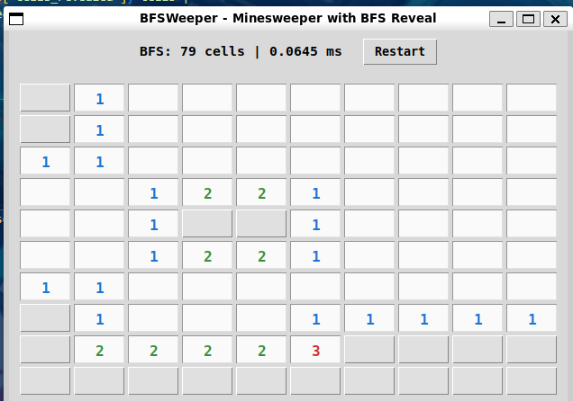
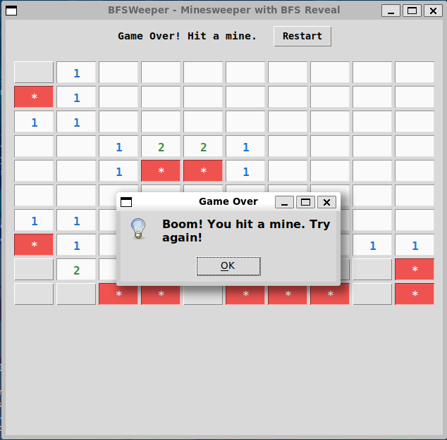
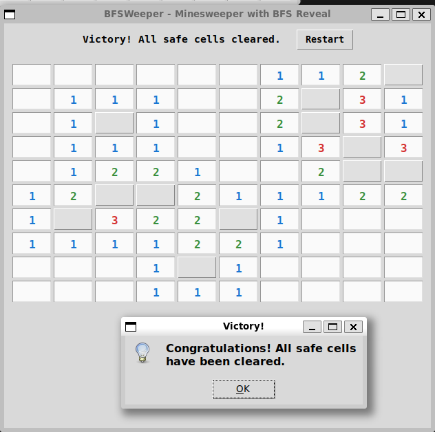

# simple-minesweeper-with-bfs-search-algorithms aka BFSweeper






# Author:
    - Handhika Putra Widyartono
    - Jovan Oberto Mishael Sinaga

# BFSweeper is a simple implementation of the classic Minesweeper game, enhanced with a Breadth-First Search (BFS) algorithm for revealing cells. This project is designed to provide an interactive and educational experience for users interested in both gaming and algorithmic concepts.

## how to run
1. Make sure you have Python installed on your system.
2. Clone this repository to your local machine.
3. Navigate to the project directory.
4. Run the following command to start the game:
   ```bash
   python src/main.py
   ```
   **additional note**: make sure you've installed tkinter library, which is usually included with standard Python installations. If you encounter any issues, please refer to the Python documentation for guidance on installing Tkinter.
   ```
